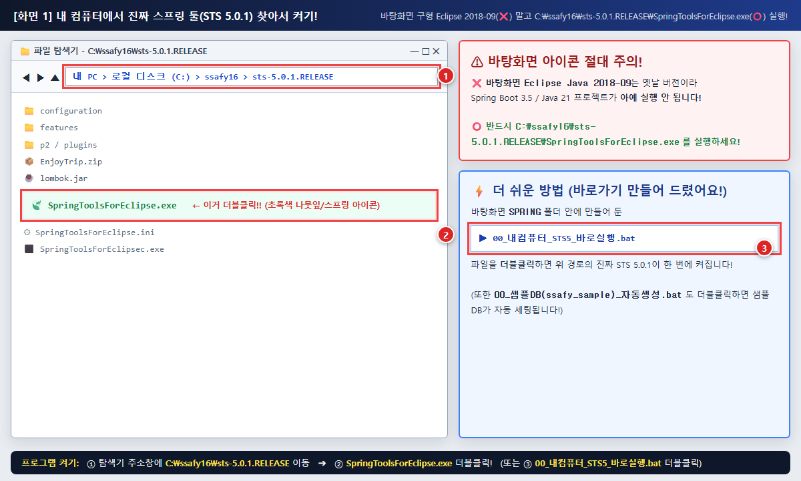
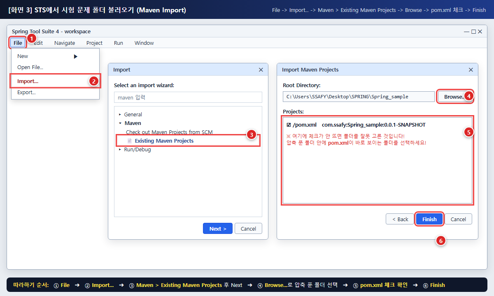
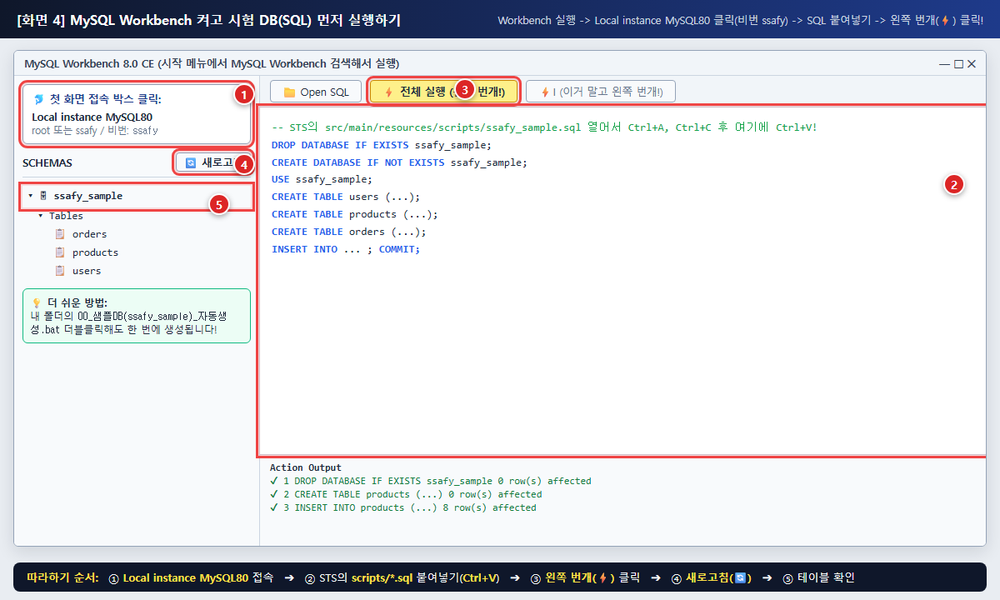
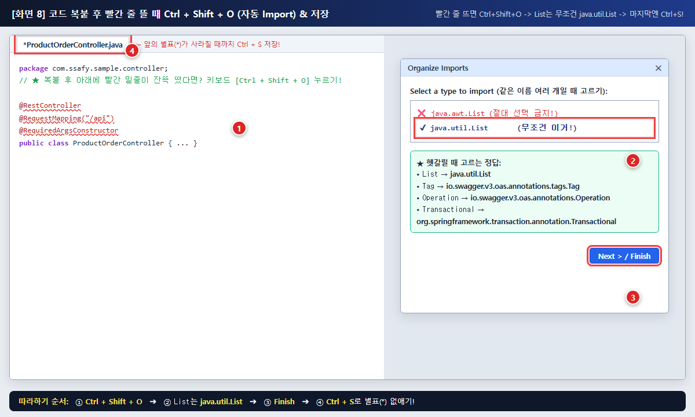
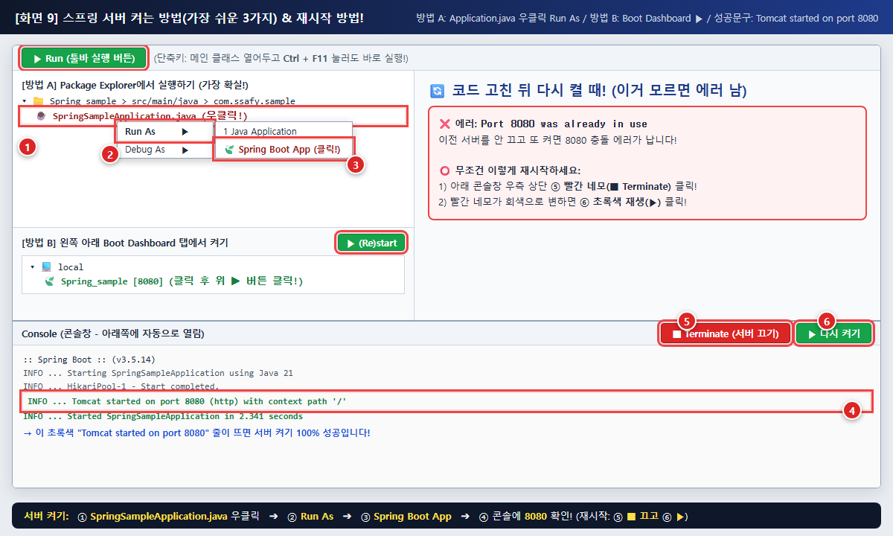
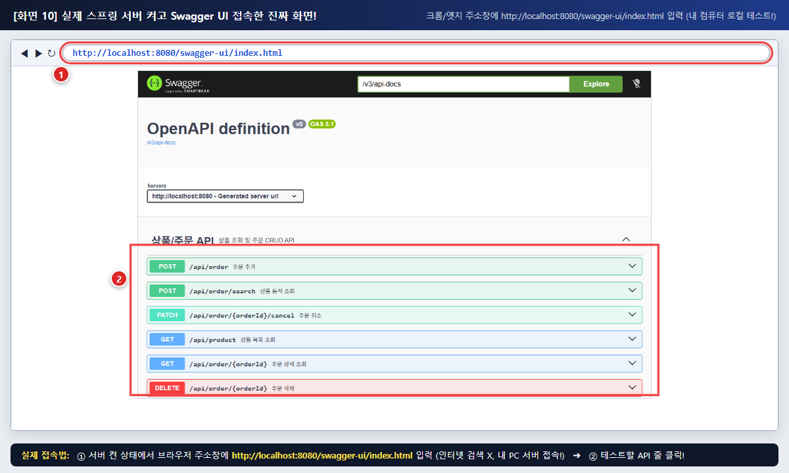
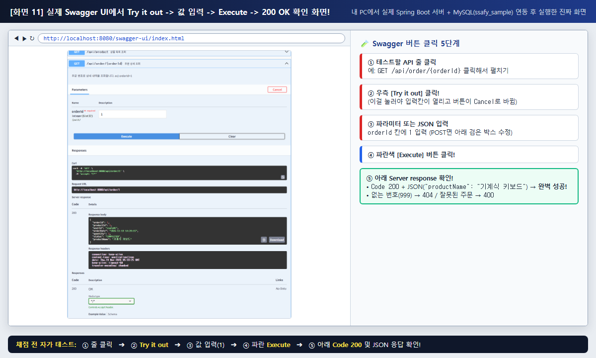
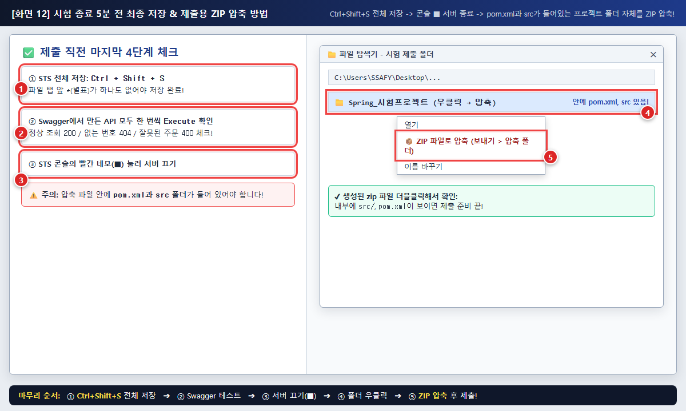

# SSAFY 16기 5회차 스프링 월말평가 통합 마스터 치트시트 (최종본)

> **대상**: 스프링·SQL·Mapper를 처음 배우는 사람도 **이 파일 1개만** 보고 시험을 풀 수 있도록 중3 눈높이로 정리한 통합본입니다.  
> **이 폴더(`SPRING`)에서 같이 열어볼 소스코드**:
> - **JUnit 8/8 전체 통과 검증 완료 프로젝트**: `Spring_Notice_8of8통과_정답프로젝트/`
> - **공지사항(Notice) 정답 + 심화 4유형 복붙 파일**: `03_공지사항(Notice)_연습정답_주석모음/` (`TODO1` ~ `TODO5`)
> - **상품/주문 샘플 정답 프로젝트**: `Spring_완벽정답_주석프로젝트/` 및 `01_복붙용_핵심_소스코드_모음/`
> - **원클릭 실행/DB 도우미**: `00_내컴퓨터_STS5_바로실행.bat`, `00_시험SQL파일_여기에_드래그하면_자동실행.bat`

---

## PART 0. 시험 전 필수 4가지 환경 세팅 & JUnit 채점 통과법

### 1. 시험 시작 전 무조건 체크해야 할 4가지 (명세서 공식 점검표)
1. **IDE**: 반드시 **STS 5.x** 사용 (`C:\ssafy16\sts-5.0.1.RELEASE\SpringToolsForEclipse.exe` — 바탕화면 구형 Eclipse 2018-09는 절대 사용 불가! 또는 `00_내컴퓨터_STS5_바로실행.bat` 더블클릭)
2. **인코딩 UTF-8 설정** (한글 깨짐 방지):
   - 상단 `Window` → `Preferences` → 검색창에 `encoding` 입력
   - ① `General > Workspace` → `Text file encoding`: `Other: UTF-8`
   - ② `General > Content Types > Text > Java Properties File` → Default encoding: `UTF-8` 입력 후 `Update`
   - ③ `Spring Properties File`도 동일하게 `UTF-8`
3. **XML DTD 자동 검사 설정** (Mapper XML 빨간 줄/자동완성):
   - `Window` → `Preferences` → `XML (Wild Web Developer)` → **`Download external resources like referenced DTD, XSD` 체크** → `Apply and Close`
4. **DB 먼저 만들기 (`schema.sql` 실행)**:
   - 시험 폴더의 `src/main/resources/schema.sql` (또는 `scripts/*.sql`) 파일을 **`00_시험SQL파일_여기에_드래그하면_자동실행.bat`** 아이콘 위에 마우스로 끌어서 딱 놓기! (또는 MySQL Workbench에서 왼쪽 번개 ⚡ 실행)

---

### 2. 내 코드가 맞았는지 확인하는 JUnit 5 테스트 실행 방법 (초록불 8/8 확인!)

> **★★★ 테스트 돌리기 직전 필수 규칙 2가지 (안 지키면 맞는 코드도 실패함!) ★★★**
> 1. **실행 중인 스프링 서버를 먼저 끄세요!** (콘솔창 우측 위 빨간 네모 `■ Terminate` 클릭)
> 2. **Swagger로 데이터 추가 테스트를 했다면 반드시 `schema.sql`을 다시 실행해 초기 데이터(4건)로 되돌리세요!** (`DaoTest`, `ServiceTest`가 DB 공지 개수가 딱 4개인지 검사하기 때문!)

- **실행 방법**: STS 왼쪽 `Package Explorer`에서 프로젝트 이름 우클릭 → **`Run As`** → **`JUnit Test`** 클릭!
- 왼쪽 아래 `JUnit` 창에 초록색 막대와 **`Runs: 8/8, Errors: 0, Failures: 0`** 이 뜨면 **100점 통과!**

---

## PART 1. 중3도 5분 만에 끝내는 SQL 완전 기초 (엑셀 비유)

### 1. DB는 그냥 엑셀 파일입니다!
- **데이터베이스(`spring_sample`)** = 엑셀 파일 1개
- **테이블(`notice`, `member`, `board_category`)** = 엑셀 시트(표) 3장
- **컬럼(`notice_id`, `title`, `content` 등)** = 표 맨 윗줄 세로 열 제목
- **행(Row)** = 데이터 1줄

| notice_id (번호) | cat_id (카테고리) | mno (작성자) | title (제목) | content (내용) | view_count | pinned | status |
| :---: | :---: | :---: | :--- | :--- | :---: | :---: | :--- |
| `1` | `1` | `1` | 5회차 월말재평가... | UTF-8 인코딩... | `15` | `TRUE` | `ACTIVE` |
| `2` | `2` | `1` | Spring Boot & MyBatis... | 트랜잭션 롤백... | `8` | `FALSE` | `ACTIVE` |

---

### 2. SQL은 이 4문장만 외우면 끝!

#### ① `SELECT` = 표에서 꺼내 보기 (조회)
```sql
-- 1) notice 표 전체를 번호 작은 순(ASC)으로 보기 (* = 모든 칸)
SELECT * FROM notice ORDER BY notice_id ASC;

-- 2) 번호가 1번인 줄만 1개 보기 (WHERE = 조건 걸기!)
SELECT * FROM notice WHERE notice_id = 1;

-- 3) 제목에 '평가' 글자가 들어있는 줄 찾기 (% = 앞뒤에 무슨 글자가 와도 됨)
SELECT * FROM notice WHERE title LIKE CONCAT('%', #{title}, '%');
```
- **정렬**: `ORDER BY notice_id ASC` (1, 2, 3 작은 순) / `ORDER BY notice_id DESC` (큰 순 = 최신순)
- **개수 제한**: 맨 끝에 `LIMIT 1` 붙이면 딱 맨 위 1줄만 나옴!

#### ② `INSERT` = 표 맨 아래에 새 줄 추가하기 (등록)
```sql
INSERT INTO notice (cat_id, mno, title, content)
VALUES (#{catId}, #{mno}, #{title}, #{content});
```
- 왼쪽 `(칸 이름들)`과 오른쪽 `VALUES (값들)`의 개수와 순서가 똑같아야 합니다!
- `notice_id`(자동 증가 번호), `view_count`(기본 `0`), `pinned`(기본 `FALSE`), `status`(기본 `'ACTIVE'`), `created_at`(현재 시간)은 `schema.sql`에 기본값이 있어서 안 써도 자동으로 채워집니다.

#### ③ `UPDATE` = 이미 있는 줄 고치기 (수정)
```sql
UPDATE notice
SET status = 'HIDDEN'
WHERE notice_id = #{noticeId};
```
- **절대 주의**: `WHERE` 빼먹으면 표의 **모든 공지사항**이 다 바뀌어 버립니다!

#### ④ `DELETE` = 특정 줄 지우기 (삭제)
```sql
DELETE FROM notice
WHERE notice_id = #{noticeId};
```

#### ⑤ `JOIN` = 표 2개를 짝지어 이름 같이 꺼내기!
`notice` 표에는 작성자 번호(`mno = 1`)만 있고, 작성자 이름(`김싸피`)은 `member` 표에 있습니다. 두 표의 `mno`가 같은 줄끼리 풀칠(`INNER JOIN`)해서 같이 꺼냅니다:
```sql
SELECT n.*, m.mno AS m_mno, m.name AS m_name, m.email AS m_email, m.role AS m_role
FROM notice n
INNER JOIN member m ON n.mno = m.mno
WHERE n.notice_id = #{noticeId};
```

---

## PART 2. 중3도 5분 만에 끝내는 MyBatis Mapper(`.xml`) 레고 조립법

### 1. 빨간 `X` 에러가 나는 가장 흔한 이유!
`<mapper namespace="...">` 는 거대한 큰 택배 상자입니다. **큰 상자 바로 안에 SQL 글자를 그냥 쓰면 100% 빨간 `X` 에러가 납니다!**  
반드시 아래 **4가지 작은 상자 중 하나를 열고 그 안에 SQL을 넣으세요**:
- 조회: `<select id="..." resultType="..."> ... </select>`
- 추가: `<insert id="..." parameterType="..." useGeneratedKeys="true" keyProperty="..."> ... </insert>`
- 수정: `<update id="..."> ... </update>`
- 삭제: `<delete id="..."> ... </delete>`

### 2. 자바(`Dao`)와 SQL(`Mapper.xml`) 연결 규칙 4가지
1. **`namespace`**: 연결할 DAO 인터페이스의 전체 주소 (예: `com.ssafy.sample.model.dao.NoticeDao`)
2. **`id`**: DAO 인터페이스 메서드 이름과 **스펠링 1글자도 안 틀리고 똑같이** 적기 (`selectAll`, `insert`)
3. **`resultType`**: `<select>` 결과를 담을 DTO 클래스 이름 (예: `Notice`)
4. **`#{변수명}`**: 자바 DTO에서 값을 꺼내 SQL 빈칸에 꽂아주는 구멍 (예: `#{title}`)

### 3. XML에서 절대 조심할 3가지
- **XML 부등호 규칙**: XML에서 `<` 는 태그 시작 기호로 착각해서 에러가 납니다!
  - `>=` ➔ **`&gt;=`**  |  `<=` ➔ **`&lt;=`**  |  `>` ➔ **`&gt;`**  |  `<` ➔ **`&lt;`**
- **자동 번호 채번**: `<insert ... useGeneratedKeys="true" keyProperty="noticeId">` → INSERT 직후 DB가 만든 번호(`5`)를 자바 `notice.getNoticeId()`에 자동으로 채워줍니다! (안 적으면 `DaoTest` 실패!)
- **동적 검색 (`<where>` + `<if>`)**: 사용자가 조건을 입력한 것만 골라서 검색할 때 씁니다 (`<where>`가 맨 앞 `AND`를 자동으로 지워줌!).

---

## PART 3. 공식 예시문제 (`Notice` TODO 1~4) JUnit 8/8 통과 완벽 코드

*(실제 제공된 `DtoTest`, `DaoTest`, `ServiceTest`, `ControllerTest` 총 8개 테스트를 직접 실행해 8/8 PASS 검증 완료한 코드입니다!)*

### TODO 1. `Notice.java` (`src/main/java/com/ssafy/sample/model/dto/Notice.java`)
- **감점 주의**: 명세서대로 **딱 9개 필드만** 선언! (필드 추가 시 `DtoTest` 실패)
- **`@Builder` 필수!** (테스트 코드가 `Notice.builder()...build()`를 직접 호출함)
```java
package com.ssafy.sample.model.dto;

import lombok.AllArgsConstructor;
import lombok.Builder;
import lombok.Data;
import lombok.NoArgsConstructor;

@Data
@NoArgsConstructor
@AllArgsConstructor
@Builder
public class Notice {
    private int noticeId;
    private int catId;
    private int mno;
    private String title;
    private String content;
    @Builder.Default
    private int viewCount = 0;
    @Builder.Default
    private boolean pinned = false;
    @Builder.Default
    private String status = "ACTIVE";
    private String createdAt;
}
```

### TODO 2. `NoticeMapper.xml` (`src/main/resources/mappers/NoticeMapper.xml`)
> **★ 명세서 vs 실제 `schema.sql` 함정 주의!**  
> 명세서 글에는 `is_pinned AS pinned`라고 적혀 있으나, 실제 `schema.sql`의 컬럼명은 `pinned`입니다!  
> **시험장에서도 반드시 `schema.sql`의 실제 컬럼명을 먼저 확인하세요!** (실제 컬럼명이 `pinned`면 `pinned`, `is_pinned`면 `is_pinned AS pinned`!)
```xml
<?xml version="1.0" encoding="UTF-8" ?>
<!DOCTYPE mapper PUBLIC "-//mybatis.org//DTD Mapper 3.0//EN"
        "http://mybatis.org/dtd/mybatis-3-mapper.dtd">
<mapper namespace="com.ssafy.sample.model.dao.NoticeDao">

    <select id="selectAll" resultType="Notice">
        SELECT notice_id, cat_id, mno, title, content, view_count, pinned, status, created_at
        FROM notice
        ORDER BY notice_id ASC
    </select>

    <insert id="insert" parameterType="Notice" useGeneratedKeys="true" keyProperty="noticeId">
        INSERT INTO notice (cat_id, mno, title, content)
        VALUES (#{catId}, #{mno}, #{title}, #{content})
    </insert>

</mapper>
```

### TODO 3. `NoticeServiceImpl.java` (`src/main/java/com/ssafy/sample/model/service/NoticeServiceImpl.java`)
- **감점 주의 1**: `getAllNotices()` 위에 **`@Transactional(readOnly = true)`** 필수! (`ServiceTest`가 직접 검사함!)
- **감점 주의 2**: `createNotice()` 위에 **`@Transactional`** 필수! (실패 시 DB INSERT 롤백 검사함!)
- **감점 주의 3**: 제목이 없거나 공백이면 `CustomBusinessException("공지사항 제목은 필수 입력 항목입니다.")` 던지기!
```java
package com.ssafy.sample.model.service;

import java.util.List;
import org.springframework.stereotype.Service;
import org.springframework.transaction.annotation.Transactional;
import com.ssafy.sample.exception.CustomBusinessException;
import com.ssafy.sample.model.dao.NoticeDao;
import com.ssafy.sample.model.dto.Notice;
import lombok.RequiredArgsConstructor;

@Service
@RequiredArgsConstructor
public class NoticeServiceImpl implements NoticeService {

    private final NoticeDao noticeDao;

    @Override
    @Transactional(readOnly = true)
    public List<Notice> getAllNotices() {
        return noticeDao.selectAll();
    }

    @Override
    @Transactional
    public Notice createNotice(Notice notice) {
        if (notice == null || notice.getTitle() == null || notice.getTitle().trim().isEmpty()) {
            throw new CustomBusinessException("공지사항 제목은 필수 입력 항목입니다.");
        }
        noticeDao.insert(notice);
        return notice;
    }
}
```

### TODO 4. `NoticeController.java` (`src/main/java/com/ssafy/sample/controller/NoticeController.java`)
- **감점 주의 1**: 클래스 주소 `@RequestMapping("/sample/notice")` 정확히 맞추기!
- **감점 주의 2**: POST 성공 시 상태코드 **`201 Created` (`HttpStatus.CREATED`)** + 본문 **`"Notice Created"`** 정확히 반환!
- **감점 주의 3**: 컨트롤러에서 `try-catch`로 예외를 잡지 마세요! (`GlobalRestExceptionHandler`가 알아서 `400 Bad Request`로 바꿔줍니다!)
```java
package com.ssafy.sample.controller;

import java.util.List;
import org.springframework.http.HttpStatus;
import org.springframework.http.ResponseEntity;
import org.springframework.web.bind.annotation.*;
import com.ssafy.sample.model.dto.Notice;
import com.ssafy.sample.model.service.NoticeService;
import io.swagger.v3.oas.annotations.Operation;
import io.swagger.v3.oas.annotations.tags.Tag;
import lombok.RequiredArgsConstructor;

@Tag(name = "Notice", description = "공지사항 관리 API (샘플)")
@RestController
@RequestMapping("/sample/notice")
@RequiredArgsConstructor
public class NoticeController {

    private final NoticeService noticeService;

    @Operation(summary = "전체 공지사항 목록 조회")
    @GetMapping
    public ResponseEntity<List<Notice>> list() {
        return ResponseEntity.ok(noticeService.getAllNotices());
    }

    @Operation(summary = "신규 공지사항 등록")
    @PostMapping
    public ResponseEntity<String> create(@RequestBody Notice notice) {
        noticeService.createNotice(notice);
        return ResponseEntity.status(HttpStatus.CREATED).body("Notice Created");
    }
}
```

---

## PART 4. 실제 월말평가 출제 1순위! 심화 4유형 통째로 복붙 코드

*(공식 명세서 4장 [자율 심화 연습 가이드] 4가지 기능을 그대로 구현할 수 있는 풀코드입니다. 상세 주석 파일은 `03_공지사항(Notice)_연습정답_주석모음/TODO5_*`에도 있습니다!)*

### 1. 심화용 DTO 추가 (`Member.java`, `NoticeSearchCondition.java`, `Notice.java` 확장)
```java
@Data @NoArgsConstructor @AllArgsConstructor @Builder
public class Member {
    private int mno;
    private String name;
    private String email;
    private String role;
}

@Data @NoArgsConstructor @AllArgsConstructor
public class NoticeSearchCondition {
    private String title;   // 제목 포함 검색
    private Integer catId;  // ★ int 말고 Integer! (검색 안 할 때 null이어야 <if test="catId != null"> 동작!)
    private Boolean pinned; // ★ boolean 말고 Boolean! (마찬가지로 null 체크용!)
}
// ★ 심화 1번(작성자 조인) 구현 시 Notice.java 에 아래 1줄 추가!
// private Member member;
```

### 2. 심화 1~4 Mapper XML (`NoticeMapper.xml`에 추가)
```xml
<!-- [심화 1] 공지(Notice) + 작성자(Member) 1:1 연결표 (<association>) -->
<resultMap id="NoticeWithMemberMap" type="Notice">
    <id column="notice_id" property="noticeId"/>
    <result column="cat_id" property="catId"/>
    <result column="mno" property="mno"/>
    <result column="title" property="title"/>
    <result column="content" property="content"/>
    <result column="view_count" property="viewCount"/>
    <result column="pinned" property="pinned"/>
    <result column="status" property="status"/>
    <result column="created_at" property="createdAt"/>
    <association property="member" javaType="com.ssafy.sample.model.dto.Member">
        <id column="m_mno" property="mno"/>
        <result column="m_name" property="name"/>
        <result column="m_email" property="email"/>
        <result column="m_role" property="role"/>
    </association>
</resultMap>

<select id="selectDetailWithMember" resultMap="NoticeWithMemberMap">
    SELECT n.*, m.mno AS m_mno, m.name AS m_name, m.email AS m_email, m.role AS m_role
    FROM notice n
    INNER JOIN member m ON n.mno = m.mno
    WHERE n.notice_id = #{noticeId}
</select>

<!-- [심화 2] 동적 검색 (<where> + <if>) -->
<select id="searchNotices" parameterType="NoticeSearchCondition" resultType="Notice">
    SELECT notice_id, cat_id, mno, title, content, view_count, pinned, status, created_at
    FROM notice
    <where>
        <if test="title != null and title != ''">
            AND title LIKE CONCAT('%', #{title}, '%')
        </if>
        <if test="catId != null">
            AND cat_id = #{catId}
        </if>
        <if test="pinned != null">
            AND pinned = #{pinned}
        </if>
    </where>
    ORDER BY notice_id ASC
</select>

<!-- [심화 3] 조회수 +1 증가 -->
<update id="increaseViewCount">
    UPDATE notice SET view_count = view_count + 1 WHERE notice_id = #{noticeId}
</update>

<!-- [심화 4] 게시글 숨김 상태('HIDDEN') 변경 -->
<update id="hideNotice">
    UPDATE notice SET status = 'HIDDEN' WHERE notice_id = #{noticeId}
</update>
```

### 3. 심화 1~4 DAO · ServiceImpl · Controller 코드
```java
// [DAO] NoticeDao.java 에 추가
Notice selectDetailWithMember(@Param("noticeId") int noticeId);
List<Notice> searchNotices(NoticeSearchCondition condition);
int increaseViewCount(@Param("noticeId") int noticeId);
int hideNotice(@Param("noticeId") int noticeId);

// [ServiceImpl] NoticeServiceImpl.java 에 추가
@Transactional // ★ 심화 3 핵심: view_count+1 직후 예외 터지면 view_count도 원래대로 롤백됨!
public Notice getNoticeDetail(int noticeId) {
    if (noticeDao.increaseViewCount(noticeId) == 0) return null; // 없는 번호
    Notice notice = noticeDao.selectDetailWithMember(noticeId);
    if (notice != null && "HIDDEN".equals(notice.getStatus())) {
        throw new CustomBusinessException("숨김 처리된 공지사항은 조회할 수 없습니다.");
    }
    return notice;
}

@Transactional(readOnly = true)
public List<Notice> searchNotices(NoticeSearchCondition condition) {
    return noticeDao.searchNotices(condition);
}

@Transactional
public boolean hideNotice(int noticeId) {
    return noticeDao.hideNotice(noticeId) > 0;
}

// [Controller] NoticeController.java 에 추가
@GetMapping("/{noticeId}")
public ResponseEntity<?> detail(@PathVariable("noticeId") int noticeId) {
    Notice notice = noticeService.getNoticeDetail(noticeId);
    if (notice == null) return ResponseEntity.status(HttpStatus.NOT_FOUND).body("Not Found");
    return ResponseEntity.ok(notice);
}

@GetMapping("/search")
public ResponseEntity<List<Notice>> search(@ModelAttribute NoticeSearchCondition condition) {
    return ResponseEntity.ok(noticeService.searchNotices(condition));
}

@PatchMapping("/{noticeId}")
public ResponseEntity<String> hide(@PathVariable("noticeId") int noticeId) {
    if (!noticeService.hideNotice(noticeId)) return ResponseEntity.status(HttpStatus.NOT_FOUND).body("Not Found");
    return ResponseEntity.ok("Notice Hidden");
}
```

---

## PART 5. JUnit 채점 감점 0점 방지 8대 함정 & 10초 응급처치 & 단어장

### 1. 시험장 감점 방지 8대 체크리스트
1. **Swagger POST 테스트 JSON 규칙 (Spring Boot 4 / Jackson 3)**: `int`, `boolean` 같은 원시 타입 필드에 `null`을 넣으면 역직렬화 오류가 나므로 명세서의 예시 JSON처럼 `"noticeId": 0`, `"pinned": false` 값을 채워 테스트하세요!
2. **DTO 필드 개수 임의 추가 금지**: 기본 `DtoTest`가 필드 개수(`9개`)를 세고 있으므로 심화 요구가 없는 기본 문제에는 필드를 추가하지 마세요.
3. **`@Transactional(readOnly = true)` 누락 금지**: 조회 Service 메서드에 테스트 코드가 어노테이션 유무를 직접 검사할 수 있습니다!
4. **응답 상태코드 & 문자열 정확히 맞추기**: `200 OK` vs `201 Created`, 반환 문자열(`"Notice Created"` 등) 대소문자·띄어쓰기 확인!
5. **`@PathVariable("id")`, `@RequestParam("id")`, `@Param("id")` 괄호 안에 이름 무조건 적기!**
6. **검색 조건 숫자/불린은 래퍼 타입(`Integer`, `Boolean`) 사용!** (`int`/`boolean` 쓰면 `!= null` 체크가 안 됨!)
7. **Swagger 테스트 끝난 후 JUnit 돌리기 전**: 반드시 ① 서버 끄기(`■`), ② `schema.sql` 다시 실행해 DB 초기화!
8. **예외가 `CustomBusinessException` + `GlobalRestExceptionHandler` 구조일 때**: 컨트롤러에서 `try-catch`로 감싸지 마세요! (예외가 밖으로 나와야 `GlobalRestExceptionHandler`가 잡아서 `400`을 줍니다!)

### 2. 에러 났을 때 10초 응급처치표

| 에러 / 증상 | 99% 원인 | 지금 바로 고칠 곳 |
|---|---|---|
| XML 파일에 빨간 X | `<mapper>` 안에 `<select>`/`<insert>` 없이 SQL 바로 적음, 또는 `<`, `<=` 사용 | SQL을 `<select>`/`<insert>` 태그 안에 넣고, `<=`는 `&lt;=`로 바꾸기 |
| `Unknown column 'xxx'` | 명세서 글과 `schema.sql`의 실제 컬럼명이 다름 (예: `is_pinned` vs `pinned`) | `schema.sql` 파일 열어서 실제 컬럼 철자 그대로 맞추기 |
| `Invalid bound statement (not found)` | XML `namespace` 오타 또는 `id`가 DAO 메서드명과 다름 | `<mapper namespace="...">`와 `<select id="...">` 철자 확인 |
| `NoSuchBeanDefinitionException` | `ServiceImpl`에 `@Service` 빼먹음 | 클래스 위에 `@Service` 붙이고 `Ctrl+Shift+O` |
| `Port 8080 was already in use` | 이전 서버 안 끄고 또 켬 | 콘솔 오른쪽 위 빨간 네모(`■`)로 끄고 다시 실행(`▶`) |
| 빨간 밑줄 (import 누락) | 복붙 후 import 안 함 | **`Ctrl + Shift + O`** (`List`는 무조건 **`java.util.List`**!) → `Ctrl + S` |

### 3. 중3 눈높이 핵심 단어장
- **DTO** (`Notice`): 데이터 담아 나르는 **도시락통** (`@Data @NoArgsConstructor @AllArgsConstructor @Builder`)
- **DAO** (`NoticeDao`): 자바와 SQL을 연결하는 **전화번호부** (`@Mapper`)
- **Mapper** (`NoticeMapper.xml`): 실제 SQL 쿼리가 적힌 **레시피북**
- **Service** (`NoticeServiceImpl`): 검사·트랜잭션(`@Transactional`) 처리하는 **주방장** (`@Service`)
- **Controller** (`NoticeController`): URL 요청 받고 결과(`ResponseEntity`) 돌려주는 **웨이터** (`@RestController`)
- **DI (`@RequiredArgsConstructor` + `private final`)**: `new` 안 해도 스프링이 알아서 부품을 꽂아주는 자동 조립

---

## PART 6. 부록: STS · MySQL · 실제 Swagger 클릭 화면 캡쳐 모음

### 1. 진짜 STS 5.0.1 위치 & 실행 (`00_내컴퓨터_STS5_바로실행.bat`)


### 2. 프로젝트 불러오기 (`File -> Import -> Existing Maven Projects`)


### 3. DB SQL 실행 (`00_시험SQL파일_여기에_드래그하면_자동실행.bat` 또는 Workbench 번개⚡)


### 4. 빨간 줄 자동 Import (`Ctrl + Shift + O` → `java.util.List`) & 저장 (`Ctrl + S`)


### 5. 서버 켜기 (`Run As -> Spring Boot App`) & 재시작 (`■` 끄고 `▶` 켜기)


### 6. 실제 서버 띄운 Swagger UI 첫 화면 (`http://localhost:8080/swagger-ui/index.html`)


### 7. 실제 Swagger UI `Try it out` → `Execute` → `200` 응답 확인


### 8. 시험 종료 전 전체 저장 (`Ctrl + Shift + S`) → 서버 종료(`■`) → ZIP 압축 제출

